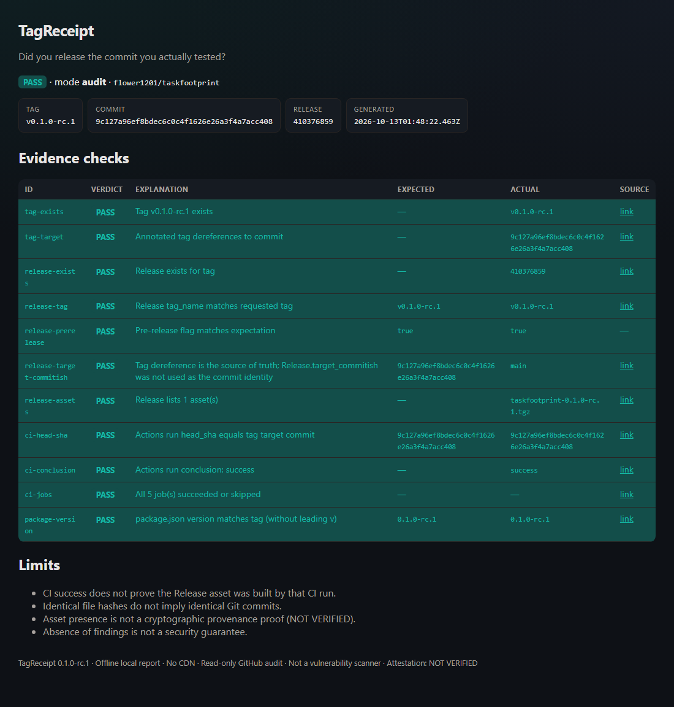

# TagReceipt

**Did you release the commit you actually tested?**

```text
Tag → Commit → CI → Release → Offline Receipt
```

TagReceipt is a **read-only** CLI that audits a GitHub tag against the exact commit it points to, the Actions run on that SHA, and the Release that claims the tag. It writes an evidence-linked offline HTML / JSON / Markdown receipt.

Local-first · No LLM · No cloud upload of your repo · MIT

> Status: **0.1.0-rc.1** on GitHub `main` (source + CI). **No GitHub Release / Tag for TagReceipt itself yet.** **npm Registry: not published.**  
> This is a **consistency auditor**, not a runtime sandbox and **not** a cryptographic attestation tool (`gh release verify` covers signatures). Asset provenance is **NOT VERIFIED**.

## Quick start — demo (real public repo)

Requires Node.js `^22.12.0 || ^24.0.0` and a working `gh` login **or** public GitHub API access.

```bash
git clone https://github.com/flower1201/tagreceipt.git
cd tagreceipt
npm install
npm run demo
```

Open `examples/out-demo/index.html` via `file://`. The demo audits **flower1201/taskfootprint@v0.1.0-rc.1** — a real tag, commit, CI run, and Pre-release.



*Screenshot from `npm run demo` against a public repository. Not a fabricated production result.*

## CLI

```bash
npm run build

# Existing Tag + Release
node ./dist/cli/index.js audit flower1201/retryscope \
  --tag v0.1.0-rc.1 \
  --out ./release-report

# Commit/CI only — Release is not required
node ./dist/cli/index.js preflight flower1201/retryscope \
  --sha <full-40-char-commit-sha> \
  --out ./release-report
```

Outputs:

```text
release-report/
├── index.html
├── receipt.json
└── summary.md
```

### Exit codes

| Code | Meaning |
|-----:|---------|
| 0 | All checks PASS |
| 1 | UNKNOWN (missing evidence, rate limit, or error) |
| 2 | At least one FAIL |
| 3 | WARN only (no FAIL / UNKNOWN) |

UNKNOWN is **never** treated as PASS.

### Useful flags

| Flag | Command | Meaning |
|------|---------|---------|
| `--tag` | audit | Required tag name |
| `--sha` | preflight | Full 40-character commit SHA |
| `--out` | both | Report directory |
| `--require-job <name>` | both | Repeatable required Actions job name |
| `--local <path>` | both | Compare local HEAD / tree to target SHA |
| `--expect-prerelease` | audit | Require `prerelease === true` |
| `--json` | both | Print receipt JSON to stdout |

## What it checks (audit)

- Tag exists; annotated and lightweight tags are dereferenced to a commit
- Release exists for that tag; pre-release flag
- `Release.target_commitish` is **not** treated as the tag target (tag dereference is authoritative)
- Actions run on the **exact** tag target SHA; required jobs
- Release asset **names** (presence only — not provenance)
- `package.json` version vs tag for JS/TS repos
- Optional local HEAD vs SHA, including **same tree / different commit**

## What it will not claim

- CI success ≠ the Release asset was built by that run
- Identical file hashes ≠ identical Git commits
- Asset exists ≠ trusted build origin
- No findings ≠ the software is secure
- Without a verified attestation: **NOT VERIFIED** / UNKNOWN, never “crypto-proven”

## Privacy

- Read-only GitHub API (`gh api` or public fetch)
- Tokens are never written into reports
- Raw API dumps and Authorization headers are not embedded
- See [SECURITY.md](./SECURITY.md)

## Competitors

`gh release verify` checks attestations. TagReceipt checks **whether the tag, commit, CI, and Release agree**. Details: [docs/COMPETITORS.md](./docs/COMPETITORS.md).

## Development

```bash
npm install
npm run typecheck
npm test
npm run build
```

## License

MIT · Copyright (c) 2026 flower1201
